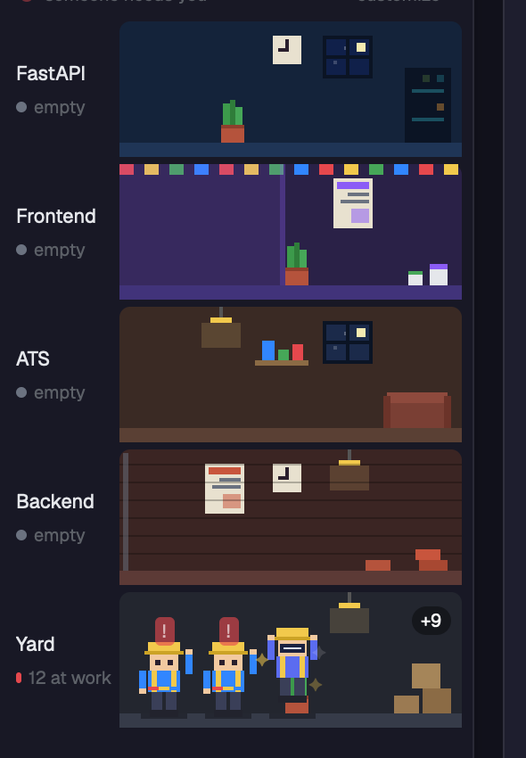

# UCTalent workspace

A Herdr layout: the UCTalent logo and name on top, and under it a building where every coding agent is a pixel construction worker on the floor of the repo it works in.



## Floors

Top to bottom: **FastAPI**, **Frontend**, **ATS**, **Backend**, **Yard** (every other repo). An agent's floor comes from its terminal's folder name (`match` patterns in `uc-workspace.json`). Agents started above the repos, e.g. in a parent folder that holds every repo, are placed by their screen instead: every few seconds the mod reads the last 150 lines of their terminal with `hc read` and takes the floor whose `screen` words appear lowest. If nothing matches the agent stays where it was, or in the Yard. Nothing is stored or sent anywhere.

## Sites (the spaces list)

Each space is a small pixel building: its windows light up per agent (amber working, red blinking needs you, green done), tiny workers stand under its name, and one line says how many are working. No branch names.

## Workers

One body, one color per agent (Claude orange, Codex blue with a visor, OpenCode with an orange scarf, Antigravity with a rainbow belt, any other agent gets a stable color from its name).

| Agent state | What the worker does |
|---|---|
| working | swings the floor's tool (hammer, paint roller, screwdriver, soldering iron, crate) |
| working in a `*review*` / `*qc*` folder, or title says "review" | white helmet, clipboard and magnifier, head sweeps left and right |
| needs you | raises an arm and waves, red `!` blinks |
| needs you for over a minute | both arms up, red `!!` blinks faster |
| done | jumps with sparkles |
| idle | coffee mug, eyes closed, `zzz` |
| out of tokens | slumps next to an empty bucket, hourglass (see below) |

Click a worker to focus its terminal. Hover for the agent, its state and how long it has been in it. No repo, branch or ticket names are shown anywhere in the building. The beacon on the roof turns red when anyone needs you.

"Out of tokens" is a guess from context use: it needs a terminal label `claude.context` (set by a Claude status line script) at or above `tokensOutAt` (95) while the agent is not working. Agents that don't report it never show this pose.

## Install

```sh
git clone https://github.com/trongkhoidev/uc-workspace
cp uc-workspace/layouts/uc-workspace.json ~/.config/herdr-app/layouts/
cp -R uc-workspace/mods/uc-brand uc-workspace/mods/uc-spaces uc-workspace/mods/uc-site ~/.config/herdr-app/mods/
herdr-app do layout.switch --name uc-workspace
```

`ctrl-shift-l` switches back to your previous layout.

## Customize

Click **customize** on the roof. It creates `~/.config/herdr-app/uc-workspace.json` with the defaults and opens it; edits apply within a few seconds.

- `motion`: `off`, `slow`, `normal`, `fast`
- `floors[]`: `name`, `match` (folder-name patterns with `*`), `screen` (words that, seen on an agent's screen, put it on this floor), `tool`, `decor` (the floor's furniture: `bricks`, `paint`, `furniture`, `circuit`, `crates`, `none`), `props` (any of `window`, `lamp`, `plant`, `poster`, `clock`, `shelf`, `rug`, `bunting`), `sky` (window color), `wall`, `floor`, `paint` colors, and `background` (a color, or an image path relative to `~/.config/herdr-app`)
- `agents{}`: `shirt`, `hat`, `scarf`, `rainbow`, `visor`, or your own pictures: `image` for every state, `images: { working, idle, ... }` per state (GIF and animated WebP play by themselves)
- `review[]`: folder patterns that count as review
- `tokensOutAt`: context percent for the out-of-tokens pose

The first floor whose `match` fits the innermost folder name wins; the floor with `"*"` catches the rest. Floors you list in your own order are shown in that order.
