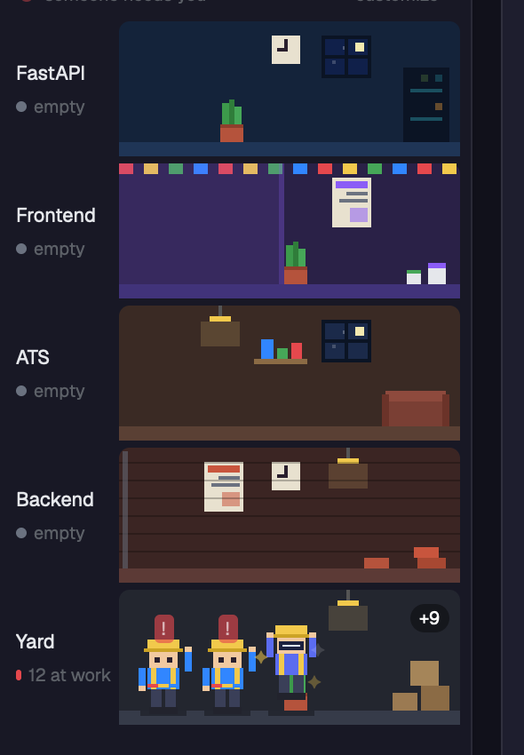

# UCTalent workspace

A Herdr layout. The sidebar shows the UCTalent logo (round, 30 px) with the name "UCTalent" and nothing under it, then the spaces list, then a building of five floors with pixel construction workers as agents.

## What you see

- Sidebar 268 px wide, background `#181825`. Top row 46 px: logo `mods/uc-brand/logo.png` (purple circle with a white hexagon spiral), "UCTalent" 15 px semibold, search and fold-sidebar buttons. No subtitle.
- Below it `spaces` (shipped mod, 96 px), then the building filling the rest, then the shipped settings footer.
- The building: a 22 px roof row (beacon dot plus "all quiet" / "someone needs you" and a "customize" button), then five floors of 76 px, top to bottom FastAPI, Frontend, ATS, Backend, Yard. Each has a 58 px label (floor name only, status dot, "N at work" or "empty") and a rounded room with its own wall and floor color, furniture and props (windows with twinkling stars, swinging-light lamps, plants, posters, clocks, shelves, bunting).
- Workers are 30x42 px bodies built from rectangles: helmet, face, shirt with two hi-vis stripes, trousers, boots, two arms. 36 px per slot; when a floor is full the last slot is a "+N" chip. Urgent agents are listed first.
- Main area, tabs, file and changes panel, status bar are the shipped Herdr mods. Focus ring and accent are purple `#8b5cf6`.

## How it behaves

Floor: the innermost folder name of the agent's terminal matched against each floor's `match` patterns in order. Poses: working (tool swings, body bobs), review (working in a review/qc folder or title containing "review"), blocked, waiting (blocked for 60 s), done, idle, empty (context label at or above 95 while not working). Click focuses the pane. All motion is native `.loop()` / `.frames()`; `motion: off` removes it.

## Built from

`layouts/uc-workspace.json` (a copy of a three-column layout with `uc-brand`, `spaces`, `uc-site`, shipped `tabs`, `pane`, `files`, `changes`, `workspace-status`). `mods/uc-brand/main.js` (logo, search via `mod.open picker`, `layout.resize` fold). `mods/uc-site/`: `main.js` (data from `agents()`, `panes()`, `terminals()`), `config.js` (defaults, glob matching, `~/.config/herdr-app/uc-workspace.json`), `sprites.js` (worker), `decor.js` (floor props). The layout depends on the herdr functions `agents`, `panes`, `terminals`, `theme`, `run`, `exec`, `readTextFile`, `writeTextFile`.

## Watch out

- The mod reads and writes only `uc-workspace.json` in the app folder and runs `open -t` (macOS) or `xdg-open` on it from the "customize" button. No network.
- Out-of-tokens is a heuristic on a Claude-only label; other agents never reach it.
- `herdr-app check` passes for both mods and the layout renders in Herdr 0.9.5 (macOS).
- Sub-agents are not drawn.

## Done when

`herdr-app check mods/uc-brand` and `check mods/uc-site` pass; switching to the layout shows the logo with only "UCTalent" beside it and five floors; an agent in a `*frontend*` folder stands on the Frontend floor; a blocked agent waves with a blinking `!`.
